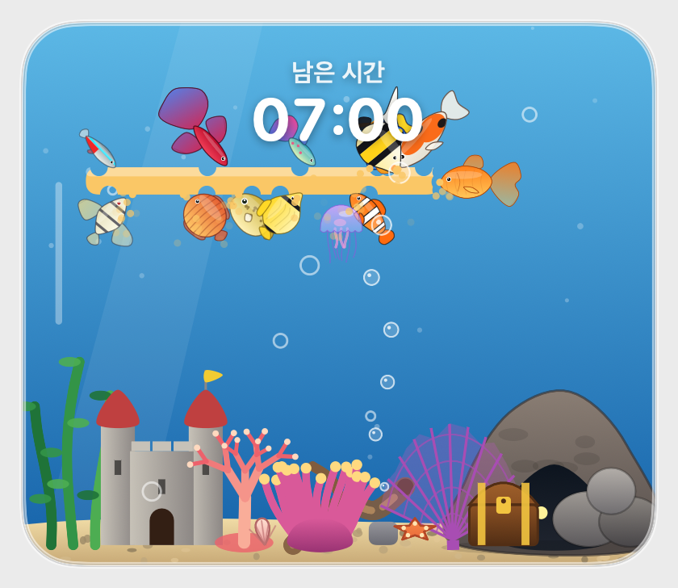
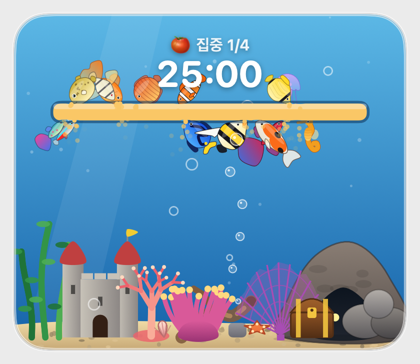
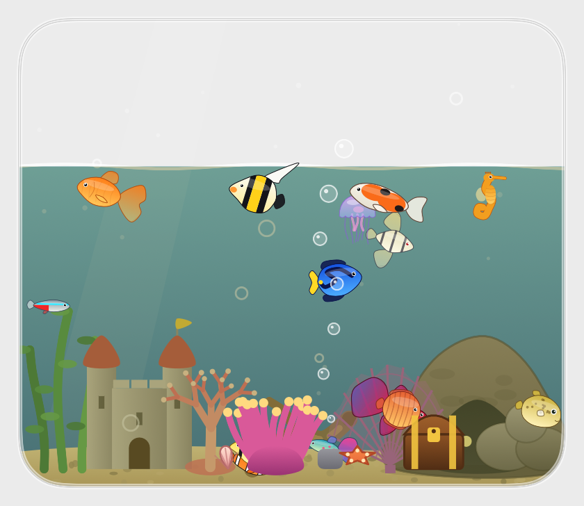

# 🐠 미니 어항 (Mini Aquarium)

Mac 화면 한쪽, **Dock 옆 빈 자리**에 떠다니는 작은 어항이에요. 물고기가 헤엄치고, 타이머를 맞추면 노란 먹이 띠를 물고기들이 천천히 갉아먹으며 남은 시간을 알려줘요.



| 🍅 포모도로 | 🔋 Mac 상태 연동 |
|---|---|
|  |  |

## 기능

- **Dock에 딱 맞는 어항** – Dock 아이콘 줄 위·아래(또는 왼쪽·오른쪽)의 빈 자리를 꽉 채워요. 아이콘이 늘고 줄어도 따라가요.
- **양쪽 이어진 어항** – 양옆을 모두 쓰면 Dock 너머로 이어진 긴 어항이 돼요. 이음새의 포털로 물고기가 건너다녀요.
- **Dock 간격 조절** – 붙임 / 좁게 / 보통 / 넓게 / 더 넓게 / 최대
- **타이머** – 분 단위 또는 목표 시각까지. 어항에 먹이만 / 시간만 / 둘 다 / 숨김 중 선택
- **포모도로** – 집중 → 휴식이 자동으로 이어지고, 단계가 바뀔 때 소리와 어항·메뉴바로 알려줘요. 시간·긴 휴식 주기는 설정에서 바꿔요. 설정에서 끄면 관상만 할 수 있어요.
- **Mac 상태 연동** (기본 꺼짐) – CPU가 바쁘면 물고기가 부산해지고, 배터리가 줄면 물이 낮아지고, 메모리가 가득 차면 물이 탁해져요. 충전 중에는 물이 가득 차요. 설정이나 메뉴에서 켜고 끌 수 있어요.
- **물고기 14종, 최대 50마리** – 금붕어, 네온테트라, 흰동가리, 블루탱, 엔젤피시, 베타, 복어, 해마, 해파리, 구피, 디스커스, 코이, 나비고기, 무어리쉬 아이돌. **추천 설정** 버튼으로 한 번에 맞출 수 있어요.
- **꾸미기** – 먹이 종류, 소품(성, 산호, 보물상자 …), 물고기·소품 크기, 어항 모양과 크기
- **메뉴바 아이콘** – 메뉴바에서 헤엄치는 물고기 종류 선택
- **한국어 / English** – 설정 맨 아래 **언어** 항목에서 바꿀 수 있어요. 처음에는 시스템 언어를 따라가요.
- **로그인할 때 자동 실행**, 메뉴바 전용 모드

## 요구 사항

- macOS 13 (Ventura) 이상
- 빌드하려면 Xcode 15+ 또는 Swift 5.9+ 툴체인

## 다운로드

**[최신 릴리스 받기 →](https://github.com/HRCEO/mini-aquarium/releases/latest)** 페이지의 *Assets*에서 `MiniAquarium-x.y.z.dmg`를 받으세요. 이전 버전과 변경 내용은 [릴리스 목록](https://github.com/HRCEO/mini-aquarium/releases)에서 볼 수 있어요.

## 설치 (dmg로 받은 경우)

1. `MiniAquarium-x.y.z.dmg`를 열고 **MiniAquarium**을 **Applications**로 끌어다 놓아요.
2. 아직 Apple 개발자 인증서로 서명·공증한 앱이 아니라서 처음에는 막힐 수 있어요. 아래 중 하나로 열어요.
   - Finder에서 앱을 **우클릭 → 열기 → 열기**
   - 또는 터미널에서: `xattr -dr com.apple.quarantine /Applications/MiniAquarium.app`
3. 실행하면 메뉴바에 물고기 아이콘이 생겨요. 클릭하면 설정이 열려요.

### 손쉬운 사용 권한 (권장)

Dock 아이콘 줄의 **실제 길이**를 읽으려면 권한이 필요해요. 없어도 동작하지만 어항 크기가 Dock과 조금 어긋날 수 있어요.

설정 → 어항(또는 정보) 탭의 **손쉬운 사용 설정 열기** 버튼을 누르고 **MiniAquarium.app**을 켜 주세요.

> 목록에 이름만 있고 `.app`이 붙지 않은 `exec` 항목은 쓰지 않아요. 지워도 돼요.

## 삭제

앱을 휴지통에 버리기만 하면 **손쉬운 사용 권한 기록과 설정이 남아요.** 완전히 지우려면 터미널에서 (저장소를 받은 경우 `scripts/uninstall.sh`, 시스템 언어에 맞춰 한국어/영어로 안내해요):

```bash
bash scripts/uninstall.sh
```

앱 종료 → 자동 실행 해제 → 손쉬운 사용 권한 기록 삭제 → 설정 삭제 → 앱 삭제 순서로 지워요. (처음 실행이 막히면 우클릭 → 열기)

## 직접 빌드하기

```bash
git clone https://github.com/HRCEO/mini-aquarium.git
cd mini-aquarium

bash scripts/make-app.sh      # build/MiniAquarium.app
open build/MiniAquarium.app   # 반드시 .app으로 실행 (자동 실행·권한이 .app 기준)

bash scripts/make-dmg.sh      # build/MiniAquarium-<버전>.dmg (배경 그림·아이콘 배치 포함, 배포용)
```

배포 절차와 버전 올리는 법은 [docs/RELEASING.md](docs/RELEASING.md), 구조는 [docs/ARCHITECTURE.md](docs/ARCHITECTURE.md)를 보세요.

## 개발

```bash
swift build                   # 디버그 빌드
swift test                    # 코어 로직 테스트 (Swift Testing, Xcode 툴체인 필요)

# 화면 녹화 권한 없이 어항을 PNG로 렌더링 (시각 확인·README 사진용)
.build/debug/MiniAquarium --snapshot out.png --size large --shape rounded --timer 0.7
```

스냅샷 옵션: `--shape rounded|bowl|tall`, `--size small|medium|large|huge`, `--timer 0.0~1.0`, `--feed`, `--dock WxH`, `--viewport x,y,w,h`, `--portal top|bottom|leading|trailing`, `--hide-remaining`, `--hide-food`, `--popover`.

## 문제 해결

| 증상 | 해결 |
|---|---|
| 권한을 켰는데도 "권한이 필요해요"가 떠요 | 설정에서 MiniAquarium.app을 끄고 지운 뒤 다시 추가. 또는 `tccutil reset Accessibility local.mini-aquarium` 후 앱을 다시 실행 |
| 자동 실행이 안 켜져요 | `.app`으로 실행해야 해요 (`open build/MiniAquarium.app` 또는 Applications에서 실행) |
| "손상되어 열 수 없음" | 위 설치 2번의 `xattr` 명령 실행 |
| 어항이 Dock과 안 맞아요 | 손쉬운 사용 권한 허용, 어항 탭의 Dock 간격 조절 |

## 제작

- 제작자: HRCEO · hrceolee@gmail.com
- 버전: 1.0.1
- 라이선스: [MIT](LICENSE) © 2026 HRCEO
- 후원: 미니 어항이 마음에 드셨다면 [Ko-fi에서 커피 한 잔](https://ko-fi.com/hrceo)으로 응원해 주세요. 후원하지 않아도 모든 기능을 똑같이 쓸 수 있어요.
